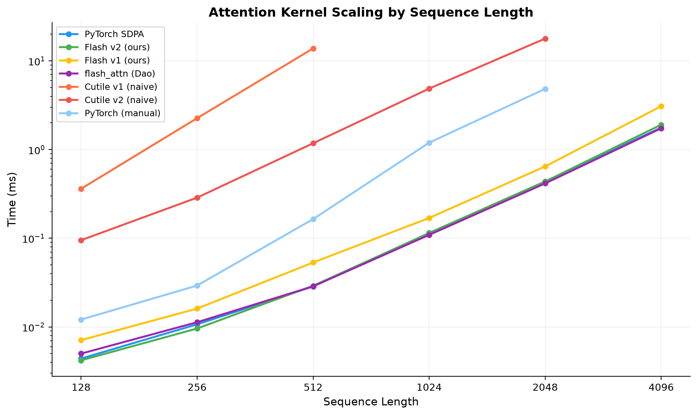

I wanted to learn cuTile, NVIDIA's Python DSL for writing GPU kernels. Instead of toy examples, I figured the best way was to implement Flash Attention from scratch -- starting from the dumbest possible kernel and working my way up to something that actually competes with PyTorch.

Every mistake in this post is one I actually made. Every gotcha is something that cost me at least 30 minutes of confused debugging. If you've written CUDA before, some of this will feel familiar. If you haven't, cuTile is a surprisingly good place to start.

## Roadmap

1. **Naive v1** - tile Q rows only, load full K and V
2. **Naive v2** - tile Q, K, and V, materialize scores to HBM for softmax
3. **FlashAttention v1** - online softmax trick, no score matrix materialized
4. **FlashAttention v2** - same algorithm, engineering optimizations for production performance

No v3 needed -- cuTile compiles `ct.mma` directly to tensor core instructions, so we get the hardware utilization for free.

## Why cuTile?

If you've used Triton, cuTile will feel familiar. You write GPU kernels at the tile level in Python -- no raw CUDA C, no thread management. You think in blocks of data, and the compiler figures out the thread-level details.

## The Attention Formula

```
attention(Q, K, V) = softmax(Q @ K^T / sqrt(d_k)) @ V
```

- **Q, K, V**: `(batch, heads, seq_len, d_k)`
- **K^T**: transpose last two dims, `(d_k, seq_len)`
- **Q @ K^T**: produces a `(seq_len, seq_len)` score matrix
- **softmax**: applied per row (`dim=-1`)

PyTorch reference:
```python
def attention(q, k, v):
    return F.softmax(q @ k.transpose(-2, -1) / math.sqrt(k.shape[-1]), dim=-1) @ v
```

## How cuTile compiles your kernel

This tripped me up early on. When you decorate a function with `@ct.kernel`, it doesn't run as Python. cuTile parses your source code and compiles it through a full pipeline:

```
Python source
    |
    v
[1] AST Parsing --> HIR (High-level IR)
    |
    v
[2] HIR --> IR (typed, operation-level)
    |
    v
[3] Optimization passes (dead code elimination, alias analysis,
    loop hoisting, loop splitting, pattern rewriting)
    |
    v
[4] IR --> TileIR Bytecode (.tileirbc, MLIR-based format)
    |
    v
[5] tileiras compiler (NVIDIA's MLIR backend) --> CUBIN
    |
    v
[6] GPU machine code, ready to launch
```

Compare this to the traditional **CUDA C++** pipeline:

```
CUDA C++ --> PTX (virtual ISA) --> SASS (machine code) --> CUBIN
               ^
               |
           nvcc compiler
```

In CUDA C++, **PTX** is the portable intermediate representation, a virtual instruction set that gets compiled down to actual GPU machine code (SASS) by the driver or `ptxas`.

cuTile skips PTX entirely. Instead, **TileIR Bytecode** serves a similar role as the portable intermediate format. It's a serialized MLIR representation that the `tileiras` backend compiles directly to CUBIN. You can dump it for inspection:
- `CUDA_TILE_DUMP_BYTECODE=./dump/` exports `.tileirbc` files
- `CUDA_TILE_DUMP_TILEIR=./dump/` exports human-readable MLIR text

`tileiras` does the heavy lifting. Compiled kernels get cached in a SQLite database, so the second run is instant.

This is also why `math.sqrt()` blows up inside a kernel -- I tried. cuTile only understands `ct.*` operations, constants, and basic control flow. Anything else and you get a cryptic compile error.

## From CUDA to cuTile

In CUDA C++, you manage two levels: `blockIdx` (which block) and `threadIdx` (which thread). In cuTile, you only think about blocks. Threads don't exist in your code.

| CUDA C++ | Cutile |
|---|---|
| `blockIdx` | `ct.bid(axis)` |
| `threadIdx` | Hidden |
| Operate on elements | Operate on tiles |

`ct.bid(axis)` gives you your block index. Every kernel starts here: "who am I, and which data is mine?"

## Memory Hierarchy

```
CPU RAM  -->  GPU HBM (global memory)  -->  GPU SRAM (shared memory / registers)
              torch tensors live here       ct.load brings tiles here
                                            computation happens here
```

`ct.load` moves data from HBM to SRAM. `ct.store` writes back. All computation happens in fast on-chip SRAM.

## Launching a Kernel

```python
stream = torch.cuda.current_stream().cuda_stream
grid = (BATCH, NUM_HEADS, math.ceil(SEQ / BLOCK_M))
ct.launch(stream, grid, my_kernel, (Q, K, V, O, scale))
```

Grid dimensions map directly to `ct.bid(axis)`:

| Grid | bid | Meaning |
|---|---|---|
| `grid[0]` | `ct.bid(0)` | batch |
| `grid[1]` | `ct.bid(1)` | head |
| `grid[2]` | `ct.bid(2)` | query row tile |

Kernels can't return values. They write to output arrays passed as arguments.

## Tiling Strategy for Attention

`Q @ K^T` produces a `(seq, seq)` matrix. When `seq` is large, it won't fit in SRAM, so we tile. **Which dimension** we tile along matters:

- **Rows only** (query dim): each tile sees **all** keys, softmax works directly
- **Columns only** (key dim): each tile sees partial keys, softmax breaks
- **Both**: requires the **online softmax trick** (FlashAttention)

```
Q @ K^T = (seq, seq)

  |-------- full row --------|
  +--------------------------+
  | tile 0 (BLOCK_M rows)   |  <-- has all scores, softmax works
  | tile 1 (BLOCK_M rows)   |
  | tile 2 (BLOCK_M rows)   |
  +--------------------------+
```

Softmax normalizes **each row independently**. It needs all `seq` scores for a given query to compute `sum(exp(x_i))`:

```
         |---- seq (softmax across this) ----|
    row 0:  [0.01, 0.03, 0.80, ...]  --> sums to 1
    row 1:  [0.10, 0.05, 0.20, ...]  --> sums to 1
    ...each row is independent
```

If you tile K, each tile only sees partial scores. You can't compute the correct softmax denominator from a partial row. This is *the* problem. FlashAttention's whole contribution is solving it.

## Naive v1: Tile Q Rows Only

Simplest possible approach: each tile loads a chunk of Q but **all** of K and V. Since we have the full score row, softmax just works.

### The full kernel, step by step

**Step 1: Block indices**

```python
batch_idx = ct.bid(0)
head_idx = ct.bid(1)
query_row_idx = ct.bid(2)
```

**Step 2: Load Q tile and full K, cast to float32, reshape to 2D**

```python
q = ct.load(Q, (batch_idx, head_idx, query_row_idx, 0), (1, 1, BLOCK_M, HEAD_DIM))
q = ct.astype(q, ct.float32)
q = ct.reshape(q, (BLOCK_M, HEAD_DIM))

k = ct.load(K, (batch_idx, head_idx, 0, 0), (1, 1, SEQ, HEAD_DIM))
k = ct.astype(k, ct.float32)
k = ct.reshape(k, (SEQ, HEAD_DIM))
```

`ct.load` gives 4D tiles `(1, 1, M, N)`. `ct.mma` needs 2D, so reshape to drop the batch/head dims. Input tensors are float16 (smaller HBM transfer), cast to float32 for precise computation.

**Step 3: Transpose K and compute scores**

```python
k_t = ct.transpose(k)  # (HEAD_DIM, SEQ)

acc = ct.zeros((BLOCK_M, SEQ), dtype=ct.float32)
acc = ct.mma(q, k_t, acc)  # (BLOCK_M, HEAD_DIM) @ (HEAD_DIM, SEQ) --> (BLOCK_M, SEQ)
```

`ct.mma` = matrix multiply-accumulate: `D = A @ B + C`. Maps to tensor core instructions. For a single matmul, start the accumulator at zeros.

**Step 4: Scale**

```python
acc = acc * scale  # scale = 1.0 / math.sqrt(HEAD_DIM), precomputed outside the kernel
```

**Step 5: Softmax with numerical stability**

```python
m = ct.max(acc, axis=-1, keepdims=True)      # row max --> (BLOCK_M, 1)
acc = acc - m                                 # subtract max, broadcasts across columns
acc = ct.exp(acc)                             # exponentiate (safe, max is 0)
denom = ct.sum(acc, axis=-1, keepdims=True)   # row sum --> (BLOCK_M, 1)
acc = acc / denom                             # normalize
```

Subtracting the row max before `exp()` prevents overflow. Same result, just numerically safe. `keepdims=True` keeps the shape as `(BLOCK_M, 1)` so it broadcasts correctly against `(BLOCK_M, SEQ)`.

**Step 6: Load V, final matmul, store**

```python
v = ct.load(V, (batch_idx, head_idx, 0, 0), (1, 1, SEQ, HEAD_DIM))
v = ct.astype(v, ct.float32)
v = ct.reshape(v, (SEQ, HEAD_DIM))

out = ct.zeros((BLOCK_M, HEAD_DIM), dtype=ct.float32)
out = ct.mma(acc, v, out)  # (BLOCK_M, SEQ) @ (SEQ, HEAD_DIM) --> (BLOCK_M, HEAD_DIM)

ct.store(O, (batch_idx, head_idx, query_row_idx, 0),
         ct.reshape(ct.astype(out, ct.float16), (1, 1, BLOCK_M, HEAD_DIM)))
```

Cast back to float16 and reshape to 4D before storing to match output tensor layout.

### Limitations

The obvious problem: this loads **all of K** and **all of V** into SRAM. SRAM (shared memory) is only 100KB to 228KB per SM depending on the GPU: 100KB on the RTX PRO 6000 Blackwell I benchmark on, 228KB on H100 and B200. K and V alone take `2 x SEQ x 64 x 2` bytes in float16: 64KB at SEQ=256, 128KB at SEQ=512, 256KB at SEQ=1024. So at SEQ=512 they already don't fit in 100KB, yet the kernel still compiles and runs, just slowly (2.26 ms at SEQ=256 and 13.83 ms at SEQ=512, about 475x slower than Flash v2 there). At SEQ=1024 and 2048 I never got a number: after two minutes the cuTile compiler (`tileiras`) was still compiling the kernel, so I stopped there. I didn't dig into where cuTile puts tiles that big. At SEQ=4096 with HEAD_DIM=64, K alone would be a 512KB tile, more than twice even the 228KB of an H100.

## Naive v2: Tile Q, K, and V

### The problem with v1

V1 loads all of K and V into SRAM at once. That works up to SEQ=512, slowly, and at SEQ=1024 it doesn't even finish compiling. For anything real, it's dead on arrival. So I need to tile K and V too.

### The new problem: softmax needs the full row

If we tile K, each `ct.mma(q, k_tile_j)` only gives us a `(BLOCK_M, BLOCK_N)` chunk of scores, not the full `(BLOCK_M, SEQ)` row. Softmax needs all scores in the row to compute `sum(exp(x_i))`.

The workaround: store score chunks to HBM, then read them back for softmax. Way more memory traffic, but at least it works for any sequence length.

### Why K and V share the same block size (BLOCK_N)

The two matmuls line up:

```
scores = Q @ K^T    --> score_chunk is (BLOCK_M, BLOCK_N)
output = scores @ V  --> V chunk needs BLOCK_N rows
```

Score block j has BLOCK_N columns (key positions). V block j has BLOCK_N rows (same positions). The inner dimension must match for the matmul:

```
(BLOCK_M, BLOCK_N) @ (BLOCK_N, HEAD_DIM) --> (BLOCK_M, HEAD_DIM)
```

### Why no accumulation when storing score chunks

We're splitting K along the **sequence dimension** (which keys), not along HEAD_DIM (the dot product itself). Each `Q_tile @ K_tile_j^T` computes complete scores for those BLOCK_N key positions:

```
Q_tile (BLOCK_M, HEAD_DIM)      K^T (HEAD_DIM, SEQ)

+--------+                      +------+------+------+
| q0 ... |                      |      |      |      |
| q1 ... |         @            | K_0  | K_1  | K_2  |
| q2 ... |                      |      |      |      |
+--------+                      +------+------+------+

                    =

Scores (BLOCK_M, SEQ)
+------+------+------+
| done | done | done |   <-- each block is complete, no accumulation
+------+------+------+
  j=0    j=1    j=2
```

If we split along HEAD_DIM instead, that would produce partial dot products that need to be added together. We're not doing that.

### But the output matmul DOES accumulate

When computing `softmax_scores @ V`, each iteration gives a **partial** contribution to the same `(BLOCK_M, HEAD_DIM)` output:

```
v1: (BLOCK_M, SEQ) @ (SEQ, HEAD_DIM)  --> (BLOCK_M, HEAD_DIM)  one shot

v2: (BLOCK_M, BLOCK_N) @ (BLOCK_N, HEAD_DIM) --> (BLOCK_M, HEAD_DIM)  partial
    each iteration contributes to the same output, must sum them all
```

### The five loops

The kernel has five sequential loops, all iterating over `(SEQ + BLOCK_N - 1) // BLOCK_N` K/V tiles:

**Loop 1: Compute score chunks, store to HBM**

```python
for j in range((SEQ + BLOCK_N - 1) // BLOCK_N):
    k = ct.load(K, (batch_idx, head_idx, j, 0), (1, 1, BLOCK_N, HEAD_DIM))
    k = ct.astype(k, ct.float32)
    k = ct.reshape(k, (BLOCK_N, HEAD_DIM))
    k_t = ct.transpose(k)

    acc = ct.zeros((BLOCK_M, BLOCK_N), dtype=ct.float32)
    acc = ct.mma(q, k_t, acc)  # (BLOCK_M, HEAD_DIM) @ (HEAD_DIM, BLOCK_N) --> (BLOCK_M, BLOCK_N)
    acc = acc * scale

    ct.store(S, (batch_idx, head_idx, query_row_idx, j),
             ct.reshape(acc, (1, 1, BLOCK_M, BLOCK_N)))
```

S is a `(BATCH, NUM_HEADS, SEQ, SEQ)` tensor in HBM, the full materialized score matrix.

**Loop 2: Find row max (for numerical stability)**

```python
row_max = ct.full((BLOCK_M, 1), float("-inf"), dtype=ct.float32)
for j in range((SEQ + BLOCK_N - 1) // BLOCK_N):
    s_tile = ct.load(S, (batch_idx, head_idx, query_row_idx, j),
                     (1, 1, BLOCK_M, BLOCK_N))
    s_tile = ct.reshape(s_tile, (BLOCK_M, BLOCK_N))
    row_max = ct.maximum(row_max, ct.max(s_tile, axis=-1, keepdims=True))
```

`ct.max` reduces each tile to `(BLOCK_M, 1)`. `ct.maximum` keeps the running max element-wise. Start at `-inf` so the first real values always win.

**Loop 3: Compute exp(s - max) and accumulate row sum**

```python
row_sum = ct.zeros((BLOCK_M, 1), dtype=ct.float32)
for j in range((SEQ + BLOCK_N - 1) // BLOCK_N):
    s_tile = ct.load(S, (batch_idx, head_idx, query_row_idx, j),
                     (1, 1, BLOCK_M, BLOCK_N))
    s_tile = ct.reshape(s_tile, (BLOCK_M, BLOCK_N))
    s_tile = ct.exp(s_tile - row_max)
    row_sum = row_sum + ct.sum(s_tile, axis=-1, keepdims=True)

    ct.store(S, (batch_idx, head_idx, query_row_idx, j),
             ct.reshape(s_tile, (1, 1, BLOCK_M, BLOCK_N)))
```

Each tile gives a partial sum. Accumulate across all tiles for the full denominator. Store the exp values back to S for the next loop.

**Loop 4: Normalize**

```python
for j in range((SEQ + BLOCK_N - 1) // BLOCK_N):
    s_tile = ct.load(S, (batch_idx, head_idx, query_row_idx, j),
                     (1, 1, BLOCK_M, BLOCK_N))
    s_tile = ct.reshape(s_tile, (BLOCK_M, BLOCK_N))
    s_tile = s_tile / row_sum

    ct.store(S, (batch_idx, head_idx, query_row_idx, j),
             ct.reshape(s_tile, (1, 1, BLOCK_M, BLOCK_N)))
```

**Loop 5: Output = softmax_scores @ V**

```python
out = ct.zeros((BLOCK_M, HEAD_DIM), dtype=ct.float32)
for j in range((SEQ + BLOCK_N - 1) // BLOCK_N):
    s_tile = ct.load(S, (batch_idx, head_idx, query_row_idx, j),
                     (1, 1, BLOCK_M, BLOCK_N))
    s_tile = ct.reshape(s_tile, (BLOCK_M, BLOCK_N))

    v = ct.load(V, (batch_idx, head_idx, j, 0), (1, 1, BLOCK_N, HEAD_DIM))
    v = ct.astype(v, ct.float32)
    v = ct.reshape(v, (BLOCK_N, HEAD_DIM))

    out = ct.mma(s_tile, v, out)  # accumulates!

ct.store(O, (batch_idx, head_idx, query_row_idx, 0),
         ct.reshape(ct.astype(out, ct.float16), (1, 1, BLOCK_M, HEAD_DIM)))
```

This is the only loop where `ct.mma` accumulation actually matters. Each iteration gives a partial `(BLOCK_M, HEAD_DIM)` result, and the accumulator sums them all up.

### The cost

Five loops. Each one reads tiles from HBM. That's a *lot* of memory traffic for something v1 did in a single pass. But hey, it works for any sequence length. No tile ever exceeds `(BLOCK_M, BLOCK_N)` in SRAM.

### Benchmarks: v1 vs v2

All benchmarks use `BATCH=4, NUM_HEADS=32, HEAD_DIM=64`. The times are GPU kernel time only, measured with the PyTorch profiler (CUPTI), so Python and launch overhead are not counted.

With `SEQ=128`:

```
                          error vs pytorch    time
PyTorch SDPA              -                   0.0044 ms
Cutile v1 (naive)         0.00048             0.361 ms
Cutile v2 (naive)         0.00048             0.095 ms
```

With `SEQ=512`, the largest size where v1 still compiles:

```
                          error vs pytorch    time
PyTorch SDPA              -                   0.0286 ms
Cutile v1 (naive)         0.00048             13.83 ms
Cutile v2 (naive)         0.00048             1.179 ms
```

With `SEQ=2048`:

```
                          error vs pytorch    time
PyTorch SDPA              -                   0.436 ms
PyTorch (manual)          0.00048             4.842 ms
Cutile v2 (naive)         0.00012             17.87 ms
```

V1 doesn't get this far: at SEQ=1024 and 2048 its compile didn't finish within two minutes, so there is no number for it. V2 works but is extremely slow: the score matrix S is read/written multiple times across 5 loops.

This is the motivation for FlashAttention: handle long sequences like v2 can, but without materializing S and without the HBM round-trips.

## FlashAttention v1: Online Softmax

### The problem with v2

V2 is correct but painfully slow. Five loops over HBM because softmax needs the full row of scores before it can normalize. And you only know the row max after seeing every K tile.

### The online softmax trick

The key insight from [Dao et al.](https://arxiv.org/abs/2205.14135): what if you compute softmax *as you go* and just correct previous results whenever a new tile changes the running max?

Three running values, all in SRAM, never touching HBM:
- `m` - running row max `(BLOCK_M, 1)`, starts at `-inf`
- `l` - running row sum of exp `(BLOCK_M, 1)`, starts at `0`
- `o` - running output accumulator `(BLOCK_M, HEAD_DIM)`, starts at `0`

### Why the correction works

Say after tile 0 you computed with `max = 5`. Then tile 1 has `max = 8`. Everything from tile 0 used `exp(x - 5)`, but it should have been `exp(x - 8)`. The fix:

```
exp(x - 5) * exp(5 - 8) = exp(x - 8)
```

`correction = exp(m_old - m_new)` rescales all previous results to use the new max.

**Correcting l (the running sum):**

```
l = exp(x1 - m_old) + exp(x2 - m_old) + ...

correction * l = exp(m_old - m_new) * [exp(x1 - m_old) + exp(x2 - m_old) + ...]
               = exp(x1 - m_new) + exp(x2 - m_new) + ...
```

The correction distributes over the sum. Every term gets rescaled.

**Correcting o (the output accumulator):**

```
o = exp(s - m_old) @ V

correction * o = exp(m_old - m_new) * exp(s - m_old) @ V
               = exp(s - m_new) @ V
```

Works because the matmul with V is linear: `(c * A) @ V = c * (A @ V)`.

If the max doesn't change, `correction = exp(0) = 1`, so it's a no-op. No if-statement needed.

### The single loop

Same setup as v2 (bid for batch/head/Q row, load Q, loop over K/V tiles), but instead of 5 loops with HBM round-trips, one loop that maintains running stats:

```python
m = ct.full((BLOCK_M, 1), float("-inf"), dtype=ct.float32)
l = ct.zeros((BLOCK_M, 1), dtype=ct.float32)
o = ct.zeros((BLOCK_M, HEAD_DIM), dtype=ct.float32)

for j in range((SEQ + BLOCK_N - 1) // BLOCK_N):
    # load K tile, compute scores (same as v2)
    k = ct.load(K, ...)
    acc = ct.mma(q, ct.transpose(k), zeros) * scale  # (BLOCK_M, BLOCK_N)

    # online softmax
    m_tile = ct.max(acc, axis=-1, keepdims=True)     # this tile's max
    m_new = ct.maximum(m, m_tile)                     # update running max
    correction = ct.exp(m - m_new)                    # rescale factor

    l = correction * l                                # fix old sum
    o = correction * o                                # fix old output

    p = ct.exp(acc - m_new)                           # exp with correct max
    l = l + ct.sum(p, axis=-1, keepdims=True)         # accumulate sum
    v = ct.load(V, ...)                               # load V tile
    o = ct.mma(ct.astype(p, ct.float16), v, o)        # fp16 in, fp32 accumulate: keeps P@V on tensor cores
    m = m_new                                         # save new max

# normalize
o = o / l
ct.store(O, ..., o)
```

No S matrix. No HBM round-trips for softmax. One loop, everything in SRAM.

### Performance tip: load V alongside K

In the pseudocode above, V is loaded right before the mma. But the GPU can overlap memory loads with computation. Loading V right after K (before the softmax math) lets the memory fetch happen while the correction/exp work runs:

```python
for j in range(...):
    k = ct.load(K, ...)
    v = ct.load(V, ...)    # <-- load early, overlaps with compute below

    acc = ct.mma(q, ct.transpose(k), zeros) * scale
    # ... softmax correction, exp, accumulate ...
    o = ct.mma(ct.astype(p, ct.float16), v, o)   # v is already in SRAM by now
```

### Benchmarks

With `BATCH=4, NUM_HEADS=32, SEQ=2048, HEAD_DIM=64`:

```
                          error vs pytorch    time
PyTorch SDPA              -                   0.436 ms
PyTorch (manual)          0.00048             4.842 ms
Cutile v2 (naive)         0.00012             17.87 ms
Flash v1 (ours)           0.00012             0.646 ms
```

~28x faster than naive v2, just from the algorithm: no `SEQ^2` score matrix, one pass, no HBM round-trips for softmax.

Small confession: my first version of this kernel was actually *slower* than naive v2 (27.18 ms at SEQ=2048). I had cast V to float32 like in the naive kernels, which turned `P @ V` into a float32 matmul, and cuTile can't run that on the tensor cores. Worse, the 64x64 float32 tiles for P, V and o didn't fit in registers, so they spilled and the kernel moved ~39 GB to and from DRAM at SEQ=2048, way more than the ~8 GB naive v2 moves while writing and re-reading its whole score matrix. Feeding P in float16 with a float32 accumulator (what FlashAttention and Triton's tutorial do) took it from 27.18 ms to 0.646 ms.

Still ~1.5x slower than PyTorch SDPA though. The algorithm isn't the bottleneck anymore -- it's the implementation details.

## FlashAttention v2: Optimized Forward Pass

The [FlashAttention v2 paper](https://arxiv.org/abs/2307.08691) improves work partitioning and reduces non-matmul operations. The core online softmax idea stays the same. I found NVIDIA's [TileGym](https://github.com/NVIDIA/TileGym) reference implementation, and it had a bunch of engineering tricks that make a huge difference. I stole most of them.

### The optimizations (all 8 of them)

1. **`@ct.kernel(occupancy=2)`** - fit 2 CTAs (thread blocks) per SM. While one waits on memory, the other computes.

2. **`ct.exp2` instead of `ct.exp`** - base-2 exponential is a native single-cycle GPU instruction. Base-e `exp` needs an extra multiply by `ln(2)`. Prescale by `1/ln(2)` inside the kernel:
```python
INV_LOG_2 = 1.0 / math.log(2)  # module-level constant
# inside kernel:
qk_scale = qk_scale * INV_LOG_2
```

3. **Fused scale-after-max** - instead of scaling all `BLOCK_M * BLOCK_N` elements then finding max, find max first and scale only the max, then fold the scale into the subtraction before exp2:
```python
# v1: scales everything, then finds max
acc = acc * scale
m_tile = ct.max(acc, axis=-1, keepdims=True)
softmax_numerator_tile = ct.exp(acc - m_new)

# v2: fused - scale only the max, fold rest into exp2
m_new = max(m, ct.max(acc, axis=-1, keepdims=True) * qk_scale)
acc = acc * qk_scale - m_new
softmax_numerator_tile = ct.exp2(acc, flush_to_zero=True)
```

4. **`latency=2/4` on loads** - tells the compiler how far ahead to prefetch data. Overlaps memory loads with compute.

5. **Float16 mma inputs** - don't cast Q, K, or V to float32. Leave them all as float16 for tensor core matmuls, which have ~2x throughput with float16 inputs. The accumulator stays float32. The naive kernels cast to float32 after loading; Flash v1 (since the fix above) and v2 skip those casts.

6. **`flush_to_zero=True`** on exp2 - skips handling subnormal numbers (tiny values near zero). Faster.

7. **`ct.truediv` with approximate rounding** - faster division for final normalization:
```python
from cuda.tile import RoundingMode as RMd
o = ct.truediv(o, l, flush_to_zero=True, rounding_mode=RMd.APPROX)
```

8. **Cast softmax scores to float16 before output mma** - matches the float16 V input for faster tensor core throughput (same as the Flash v1 fix):
```python
o = ct.mma(softmax_numerator_tile.astype(Q.dtype), v, o)
```

### Benchmarks

All benchmarks use `BATCH=4, NUM_HEADS=32, HEAD_DIM=64`, timed the same way (GPU kernel time only).

With `SEQ=512`:

```
                          error vs pytorch    time
PyTorch SDPA              -                   0.0286 ms
flash_attn (Dao)          0.00012             0.0287 ms
Flash v2 (ours)           0.00048             0.0291 ms
Flash v1 (ours)           0.00048             0.0533 ms
Cutile v2 (naive)         0.00048             1.179 ms
```

With `SEQ=2048`:

```
                          error vs pytorch    time
flash_attn (Dao)          0.00012             0.416 ms
PyTorch SDPA              -                   0.436 ms
Flash v2 (ours)           0.00024             0.437 ms
Flash v1 (ours)           0.00012             0.646 ms
Cutile v2 (naive)         0.00012             17.87 ms
```

Flash v2 matches PyTorch SDPA up to SEQ=2048 (about 8% slower at 4096), and at SEQ=512 the three fast kernels are within 2% of each other. ~1.5x faster than our unoptimized flash v1, same algorithm, just better use of the hardware.

### Autotuning tile sizes

Up to this point I'd been hardcoding BLOCK_M = BLOCK_N = 64. That's lazy. The optimal tile size depends on sequence length, head dimension, and the specific GPU. Larger tiles = fewer loop iterations but more SRAM pressure. Smaller tiles fit easily but have overhead.

The fix: pass BLOCK_M and BLOCK_N as `ct.Constant[int]` kernel parameters, then brute-force every valid combination and keep the fastest.

```python
_TILE_CONFIGS_BY_HEAD_DIM = {
    32:  ([64, 128], [32, 64]),
    64:  ([64, 128, 256], [32, 64, 128]),
    128: ([64, 128, 256], [32, 64, 128]),
    256: ([64, 128],      [32, 64]),
}
```

Larger HEAD_DIM means each tile uses more SRAM, so fewer tile size options. For each `(seq, head_dim)` pair, the autotuner:
1. Generates all valid `(BLOCK_M, BLOCK_N)` combos where `seq` is divisible by both
2. Times each combo with warmup + averaged iterations, measuring GPU kernel time the same way as the tables (`kernel_time_fn`)
3. Caches the winner so subsequent calls skip autotuning

```
[autotune] seq=512 head_dim=64
    BLOCK_M= 64 BLOCK_N= 32 -> 0.033 ms
    BLOCK_M= 64 BLOCK_N= 64 -> 0.031 ms
    BLOCK_M= 64 BLOCK_N=128 -> 0.033 ms
    BLOCK_M=128 BLOCK_N= 32 -> 0.029 ms    <-- winner
    BLOCK_M=128 BLOCK_N= 64 -> 0.032 ms
    BLOCK_M=128 BLOCK_N=128 -> 0.117 ms
    BLOCK_M=256 BLOCK_N= 32 -> 0.137 ms
    BLOCK_M=256 BLOCK_N= 64 -> 0.116 ms
    BLOCK_M=256 BLOCK_N=128 -> 0.231 ms
```

Each unique `(BLOCK_M, BLOCK_N)` triggers a separate kernel compilation (cuTile caches these). The first call pays the compilation + autotuning cost, but every subsequent call with the same `(seq, head_dim)` uses the cached optimal config.

### Closing the gap

I compared my kernel line-by-line with NVIDIA's TileGym reference implementation and found two more wins:

1. **Load K pre-transposed** with `order=(0,1,3,2)` in `ct.load`, eliminating the separate `ct.transpose()` call
2. **Fused softmax update**: compute `qk * qk_scale - m_new` once and reuse, instead of scaling separately for max and exp2. Also fuse `l = l * alpha + l_new` into one operation instead of two

Final timings with both changes:

```
SEQ=2048:  PyTorch SDPA: 0.436ms  Flash v2 (ours): 0.437ms  flash_attn (Dao): 0.416ms
SEQ=4096:  PyTorch SDPA: 1.770ms  Flash v2 (ours): 1.908ms  flash_attn (Dao): 1.739ms
```

### Comparison with Tri Dao's flash_attn

I also benchmarked against [flash_attn](https://github.com/Dao-AILab/flash-attention) by Tri Dao (the original Flash Attention author). My cuTile kernel matches PyTorch SDPA up to SEQ=2048 (within ~8% at 4096) and sits within ~10% of Dao's hand-tuned CUDA implementation. Timed this way, Flash v2, SDPA and Dao are all within 19% of each other from SEQ=128 to 512 (mine is even the fastest at SEQ=128 and 256). From SEQ=1024 up, Dao's kernel is the fastest, and at SEQ=4096 it is about 10% ahead of mine. (When I timed wall-clock instead, Dao looked up to ~4.6x slower than mine at small sizes, but that was Python overhead in `flash_attn_func`, not its kernel.)



Pretty good for a few hundred lines of Python.

## Gotchas that burned me

### Tile dimensions must be powers of two

`ct.load` will error on shapes like `(64, 24)`. Use 32, 64, 128, etc.

### No Python stdlib inside kernels

`math.sqrt()`, `len()`, etc. won't work inside `@ct.kernel`. The compiler doesn't know what they are. Precompute everything outside and pass it in.

### `ct.transpose()` vs `.transpose()`

This one cost me hours. `.transpose(-1, -2)` creates a *view* -- it swaps logical dimensions but the data stays in the same physical layout. `ct.mma` reads the raw bytes and silently produces garbage. No error, no warning, just wrong numbers.

**Always use `ct.transpose(k)`** for data going into `ct.mma`. It actually rearranges the data in SRAM.

### Dtype rules for `ct.mma`

- Inputs must have the **same dtype** (both float16, or both float32)
- float32 x float32 compiles fine but does not run on the tensor cores (that is what made my first Flash v1 slow), so feed float16 inputs
- The **accumulator** is always float32 (tensor cores accumulate in fp32)
- Typical pattern: float16 inputs, float32 accumulator, cast output back to float16

### `ct.load` uses tile indexing, not element indexing

This was the nastiest bug. `ct.load` expects a **tile index**, not an element index. cuTile auto-multiplies by the tile size internally.

```python
# WRONG: element index (produces NaN/garbage for tile > 0)
q = ct.load(Q, (batch_idx, head_idx, query_row_idx * BLOCK_M, 0), (1, 1, BLOCK_M, HEAD_DIM))

# CORRECT: tile index (cuTile multiplies by BLOCK_M internally)
q = ct.load(Q, (batch_idx, head_idx, query_row_idx, 0), (1, 1, BLOCK_M, HEAD_DIM))
```

Same for loop variables: `j` not `j * BLOCK_N`. I didn't catch this for a long time because with a single tile, `0 * BLOCK_M = 0` -- it's correct by accident. The moment I added a second tile, everything produced NaN. Lovely.

### Reductions use `axis=`, not `dim=`

```python
ct.max(tile, axis=-1, keepdims=True)   # not dim=-1
ct.sum(tile, axis=-1, keepdims=True)
```

- `ct.max(tile, axis)` reduces along an axis
- `ct.maximum(a, b)` is element-wise max of two tiles

## Wrapping up

Four kernels. Zero CUDA C++. Zero PTX. Zero SASS.

Started with a kernel that chokes on long sequences. Ended with something that nearly matches PyTorch's `scaled_dot_product_attention` and sits within ~10% of [Tri Dao's flash_attn](https://github.com/Dao-AILab/flash-attention) -- the gold standard.

The progression, in case it's useful for someone else's learning path:
- **Naive v1**: load everything into SRAM, compute, store. Already 13.8 ms at SEQ=512, and at SEQ=1024 it doesn't even finish compiling.
- **Naive v2**: tile everything, 5 HBM round-trips for softmax. Correct but brutal.
- **Flash v1**: online softmax. One loop. No score matrix. Everything stays in SRAM. ~28x faster than naive v2 (once V stays in float16).
- **Flash v2**: same algorithm, 8 engineering tricks stolen from NVIDIA's [TileGym](https://github.com/NVIDIA/TileGym). From ~0.65ms to ~0.44ms at SEQ=2048.

I didn't write a single thread-level instruction. cuTile handled threads, memory coalescing, and tensor core dispatch. I just wrote the tiling logic and the math. `tileiras` turned it into GPU machine code.

All code is at the repo root. `python3 attention.py` to reproduce.

If you spot errors or have suggestions, [open an issue](https://github.com/Charbel199/cutile-flashattn/issues) or DM me.
